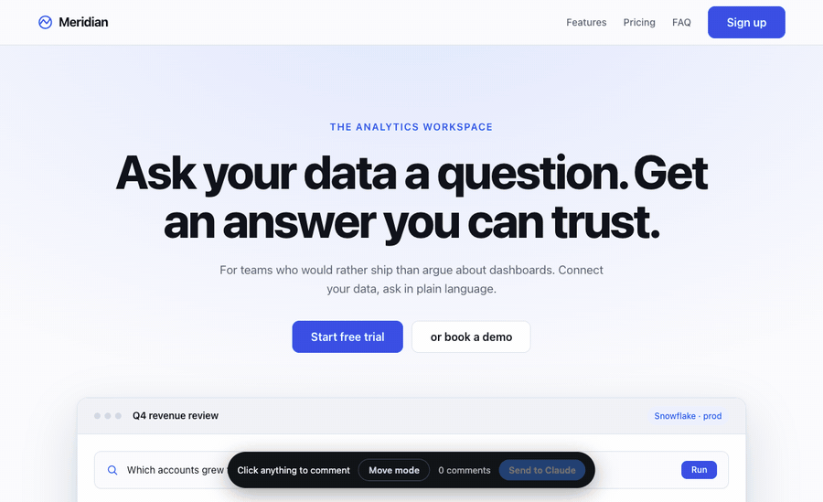

# ayna

*ayna — mirror.* A Claude Code plugin that lets Claude **see** the UI it just built.

Reading CSS tells you what was *intended*. A screenshot tells you what the user
*gets*. Ayna closes that gap: it renders the running page in real Chrome, hands
Claude the image, and loops critique → fix → re-shoot until it looks right.

And when words aren't enough, you can **click the thing you mean** and comment on it.



*Click an element → say what's wrong → Claude edits → the page reloads with your
comment re-anchored on the change → approve it. The window never closes on you.*

## Install

```bash
git clone https://github.com/devshahriar/ayna && cd ayna
npm install
npm run setup      # links it where Claude Code looks
```

Then start a new Claude session anywhere and run `/ayna:fix`.

Requires Node 20+, Google Chrome, and Claude Code. `playwright-core` drives your
installed Chrome — no browser download, no API key. `npm run uninstall` removes
the links again; it only ever touches links it made itself.

You drive it. Nothing runs on its own — no hooks, no automatic screenshots:

| command | what it does |
|---|---|
| `/ayna:look` | screenshot + critique, **changes nothing** |
| `/ayna:loop` | shoot → critique → fix → verify, on repeat |
| `/ayna:review` | opens the page so **you** click parts and comment; Claude fixes exactly those |
| `/ayna:fix` | Claude audits it, proposes fixes grouped by cause, and re-measures each one you approve |

Asking in words works too — *"screenshot the page"*, *"how does this look?"*,
*"self improve my UI"*.

## Point at what you mean

```bash
node bin/ayna.mjs annotate
```

Chrome opens with an overlay:

| | |
|---|---|
| **Click** an element | leave a comment on it |
| **Drag a box** | comment on a whole area — the crop is exactly what you framed. The only way to point inside a `<canvas>` (diagrams, charts, maps), where there are no elements to click |
| **↑ / ↓** | walk up and down the DOM, like devtools — grab the card, not the `<span>` inside it |
| **⇧ Shift-click** | select several elements for a single comment |
| **Paste, drop, or pick an image** | attach a visual reference to the comment |
| **Move mode → drag** | reorder an element among its siblings; the page updates live |
| **Tasks** | every unresolved comment across the whole project, grouped by page — click one to jump to it, approve or reject it from the list |
| **Browse mode** | the app works normally — click through its own UI, follow links, or type a URL — so you can review any page in one session |
| **Use any form** | fields and submit buttons work in comment mode; alt-click one to comment on it instead |

### Apps behind a login

```bash
node bin/ayna.mjs login          # opens the app; you sign in; the session is saved
```

An audit that hits a sign-in screen stops and says so rather than reporting on the
login page. Claude never types your credentials — it opens the window and waits.

Sign in yourself, in that window. Form fields and submit buttons work in comment
mode, so you can just fill it in and click through. A page with a password field
also drops into browse mode so nothing gets in the way. The Chrome profile persists
in `.ayna/profile`, so it is normally a one-time step. `--fresh-profile` starts logged
out when you want to check a signed-out view.

**Ayna never sees your credentials** — you type them into your own app, and nothing
you type is captured. The comment payload is asserted clean in the test suite.

Press **Send to Claude**. For each comment Claude gets:

- **a crop of exactly what you selected** — not the whole page
- your comment, and any reference image you pasted
- the precise selector (`#hero > div.container > h1`), for every element in the set
- **`file:line` candidates in your source** — found by grepping the element's id,
  classes, and text back through the project
- computed styles and rendered `outerHTML`
- for a drag: the final sibling order you want, so it gets reproduced in the source
  rather than faked with CSS

So instead of *"the headline looks cramped"* reaching Claude as a guess, it arrives
as: this element, this crop, this file, this line, these styles.

Claude runs it as an event stream (`annotate --events`), so every round you send
notifies it directly — there is no polling and nothing to re-arm.

**Your window stays open.** Claude edits, the page reloads itself, and **every
portion you commented on is highlighted again in place** — so you judge each change
where it happened.

**The verdict sits on the element itself** — every changed portion gets its own
**Looks right** / **Needs work** buttons, right there. Rejecting one sends just
that comment back for another attempt; the rest are left alone. Approved comments
don't disappear — they collapse to a green ✓ badge you can click to re-read, so by
the end of a session the page carries the record of everything that changed.

Only **Approve & close** ends the session.

## Auditing the window you're in

```bash
node bin/ayna.mjs audit
```

If a review window is open, this measures **that window, in its current state** —
it doesn't close it and it doesn't reload. Get the app into the state you care
about (a live view, an expanded panel, a menu open) and audit exactly that. Faults
that only exist after you click into something are invisible to a page at rest.

## When Claude finds something itself

Claude can audit your UI and spot faults you never mentioned. It does **not** edit
your project off its own judgement. Each finding arrives in the same review window
as a dashed purple marker — *"Claude suggests"* — with the fix it wants to make
written out. You answer it there:

- **Go ahead** → it makes the change, then you judge the result like anything else
- **Leave it** → dropped
- **Type something instead** → your words replace the suggestion, and it does that

Your comments are instructions. Its findings are suggestions. Nothing in your
project changes without a yes.

## Work that outlives the window

```bash
node bin/ayna.mjs watch    # announces tasks as they appear, forever
node bin/ayna.mjs tasks    # everything raised here and where it stands
```

Comments are **tasks on disk**, not state in a browser window. Close the window,
end the session, reboot — a task you never approved is still waiting, and the next
session is told about it before you have to ask. `watch` reports what is already
owed the moment it starts.

## Automated QA

Flows are a test suite, versioned with the code:

```bash
node bin/ayna.mjs qa          # runs every flow in ayna-flows/, exit 1 on failure
```

Each flow asserts what must hold — no console errors, a settle-time budget, and
**no layout faults**. That last one matters: every flow ends in a layout audit, so
a journey whose steps still pass but which now hides a control behind a panel
fails the run. It also diffs against the last baseline and reports what *changed*:
broke, fixed, slower, or new faults.

## The loop

```
look ──► critique ──► improve ──► recheck ──► verify ──┐
  ▲                                                     │
  └─────────────────────────────────────────────────────┘
```

1. **look** — loads the page at every configured viewport, screenshots full-page,
   and records what a screenshot can't show: console errors, horizontal overflow,
   sub-12px text, blank renders.
2. **critique** — scores the page 0–10 and ranks issues, each with a concrete fix,
   grounded in the screenshot rather than in what the source implies.
3. **improve** — works the issue list top-down. Visual pass only; the copy stays.
4. **recheck** — re-renders and re-screenshots.
5. **verify** — compares both sets skeptically: did it actually get better, what
   regressed?

Snapshots are taken before every edit, so any round can be rolled back.

## Two ways to run it

|  | in-session (default) | standalone |
|---|---|---|
| brain | the Claude session you're in | spawned `claude -p` subprocesses |
| cost | near-free — context is already warm | ~$1.50–3.30 per iteration |
| use for | interactive work | CI, unattended runs |
| entry | the `ayna` skill / `/ayna:loop` | `node bin/ayna.mjs loop -n 3` |

The in-session path is why the plugin form matters: Claude reads the PNG with its
own Read tool and edits with its own Edit tool, so there are no extra model calls
and no re-reading your source three times per round.

## CLI

```bash
node bin/ayna.mjs shot --json          # screenshot; prints paths + diagnostics
node bin/ayna.mjs annotate             # click-and-comment overlay
node bin/ayna.mjs comments --json      # what was marked up
node bin/ayna.mjs snapshot --root src  # back up before editing
node bin/ayna.mjs restore --root src   # undo a bad round
node bin/ayna.mjs record --score 7 --note "fixed FAQ alignment"
node bin/ayna.mjs report --open        # before/after HTML report
node bin/ayna.mjs loop -n 3            # unattended (costs money)
node bin/ayna.mjs critique             # tell me what's wrong, change nothing
```

`--headed` shows the Chrome window (headless by default, except `annotate` which is
always headed).

`--url` takes any page, deep links included — path, query and hash are honoured:

```bash
node bin/ayna.mjs annotate --url http://localhost:3031/d/d-835f8b1a49a73b39
node bin/ayna.mjs shot --url http://localhost:3000/settings/billing
```

## Config

`ayna.config.json` in *your* project (falls back to the plugin's defaults):

```jsonc
{
  "target": {
    "root": "src",                    // directory Ayna may edit and snapshot
    "url": "http://localhost:5173",   // your dev server
    "startCommand": "npm run dev",    // optional; Ayna will boot it
    "port": 5173,
    "routes": ["/", "/pricing", "/settings"]   // every page worth reviewing
  },
  "viewports": [
    { "name": "desktop", "width": 1440, "height": 900 },
    { "name": "mobile",  "width": 390,  "height": 844 }
  ],
  "loop": { "iterations": 3, "targetScore": 8.5, "verify": true, "autoRevert": true },
  "goal": "..."
}
```

`goal` is the highest-leverage setting — the critic scores against it, so *"a dense
operator console, information-first"* produces a very different loop than the
default landing-page goal.

## Safety

- Every round is snapshotted first; `restore` puts it back. No git required.
- Rollback fires only on evidence about the *page* — blank render, new console
  errors, verifier-confirmed regressions.
- **A dead server is not a UI regression.** If the shot is a Chrome error page,
  Ayna restarts the server and re-shoots rather than reverting work it never saw.
- `after` screenshots are kept even for reverted rounds, so you can check the
  rollback was right.
- It edits what `target.root` points at. That boundary is a convention the skill
  follows plus a snapshot you can roll back — **not a sandbox**. Point it somewhere
  you're happy to have rewritten.

## Known limitations

Written down because finding these yourself, mid-task, is worse than reading them
here.

**Nothing inside a `<canvas>` can be measured.** Diagram editors, charts, maps and
3D are pixels with no DOM behind them, so `audit` sees one element where you see a
hundred. Frame a region and comment on it instead — the crop is the message.

**Source mapping is a grep, not a compiler.** It matches ids, class names and text
back through your files, which works well for plain HTML, JSX, Vue and Svelte. On
CSS-in-JS with generated class names it will often find nothing. The selector,
crop and computed styles still arrive, so Claude can work — it just has to find
the file itself.

**Cross-origin iframes are opaque.** Embedded widgets, payment fields, anything
from another origin. Browser security, not something ayna can route around.

**`ayna loop` has no tests.** It is the standalone path that spawns its own Claude
sessions and costs real money. Everything else here is covered; that is not. Use
the in-session flow unless you specifically want unattended runs.

**Windows is untested.** The fallbacks exist — a JS file scanner where `grep` is
absent, a platform-aware "open" — but they have never been run there.

**Rejecting a change does not undo it.** It marks the task for another attempt and
leaves the edit in your files. `restore --root <dir>` rolls back the whole round.
Per-task revert is not built.

**It only knows what it can measure.** "This control cannot be clicked" is a fact.
"This looks wrong" is not, and ayna will not tell you. Taste is still yours.

**Two days old.** Written and used hard, on a handful of real apps. Expect rough
edges in proportion to that.

## Layout

```
SKILL.md            the in-session loop — the plugin's actual behavior
commands/           /ayna, /ayna:look, /ayna:review
bin/ayna.mjs        CLI
src/annotate.mjs    click-to-comment capture, crops, source mapping
src/overlay.js      the in-page annotation UI (runs in the browser)
src/browser.mjs     Chrome control, screenshots, diagnostics
src/loop.mjs        standalone orchestration
src/report.mjs      HTML report
demo/               a deliberately mediocre landing page to improve
```
