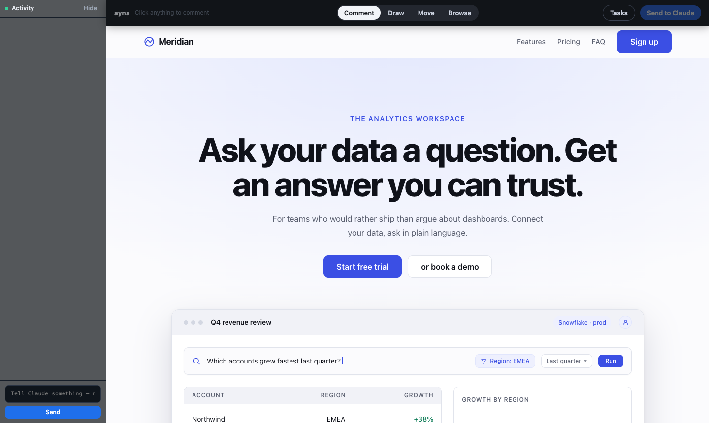
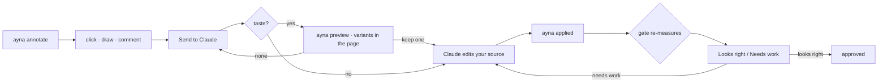
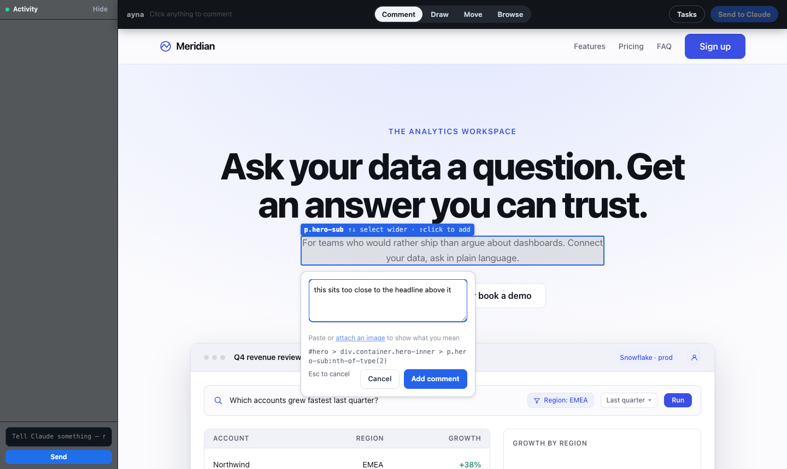
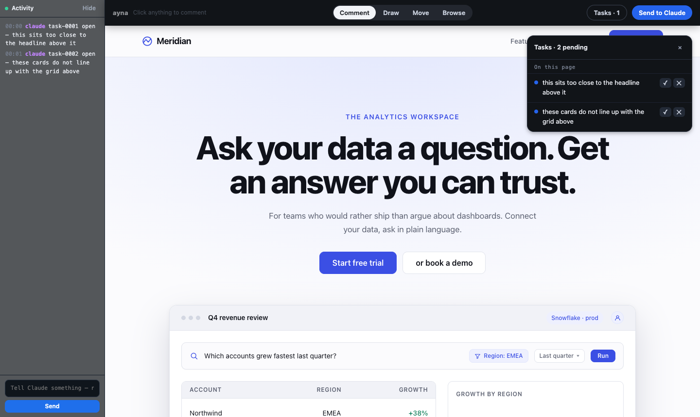
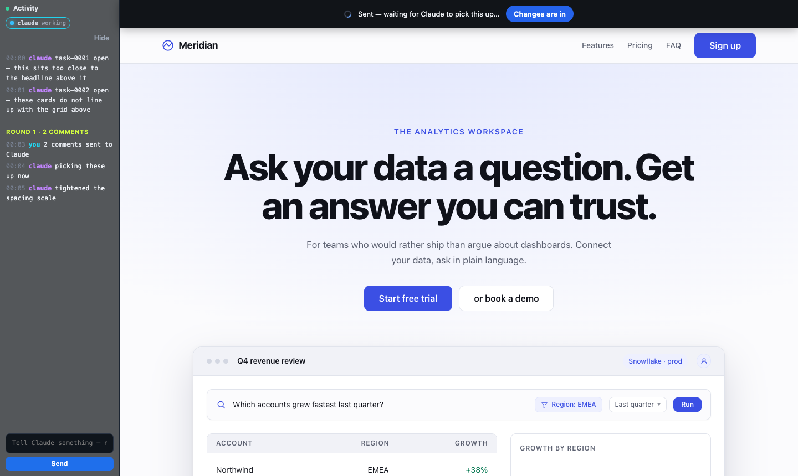
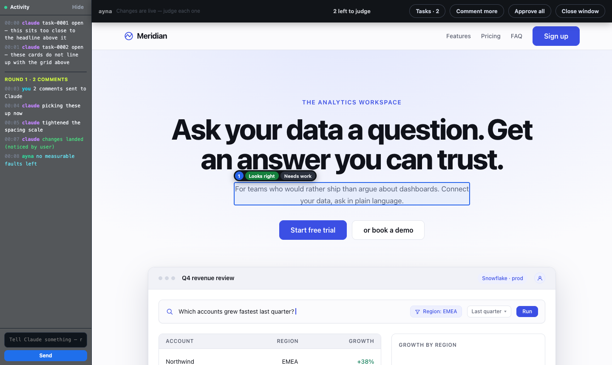
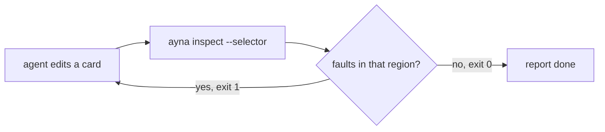

# ayna

**Claude can write your UI. It cannot see it.** ayna drives real Chrome, puts the
running page in front of both of you, and turns "this looks wrong" into something
either of you can point at, measure, and check afterwards.



Three ways to use it, and they share one store:

| | who drives | what it is for |
|---|---|---|
| **Review** | you, clicking | mark up a page, Claude fixes exactly what you marked |
| **Inspect** | an agent | check one region headlessly, before reporting work done |
| **Work** | nobody | drain the queue unattended, verifying as it goes |

---

## Install

```bash
git clone https://github.com/devshahriar/ayna && cd ayna
npm install          # playwright-core only — it drives the Chrome you have
npm run setup        # links the skill and the `ayna` command
```

Requires **Node 22.13 or newer** (the store is `node:sqlite`, which 22.12 and
earlier do not have without a flag) and a Chrome or Chromium on the machine.
Nothing is downloaded at runtime.

Start a new Claude Code or puku-cli session and try `/ayna:review` (or just
`/ayna`), or run `ayna` yourself.

### Puku CLI

`npm run setup` links the skill into `~/.puku-cli/skills/ayna`, so `/ayna` works
in a new puku-cli session. The Puku editor gets `~/.puku/skills/ayna`.

The per-workflow commands are a plugin. Load the checkout for one session:

```bash
puku-cli --plugin-dir /path/to/ayna
```

Then `/ayna:look`, `/ayna:review`, `/ayna:fix`, `/ayna:design` and `/ayna:qa` are
available. Headless runs can use puku for the model work too:

```bash
ayna work --brain puku
ayna loop --brain puku
```

The model is passed through; puku understands `puku-ai-*` as well as the
`opus`, `sonnet` and `haiku` family aliases.

---

## Flow 1 — Review: you point, Claude fixes



### 1. Open the page

```bash
ayna annotate --events --url http://localhost:3000
```

Real Chrome, your profile, your logins. The overlay docks a rail down the left
and a mode bar across the top, and **reserves that space** — it never covers the
app it is showing you.

### 1b. For anything that is a matter of taste, try it first

```bash
ayna preview --selector ".hero h1" \
  --css "font-size: 34px; font-weight: 700"   --label "bolder" \
  --css "font-size: 44px; letter-spacing: -0.02em" --label "much bigger"
```

Two or three versions appear on your page. Cycle them with **← →**, keep one with
**Enter**, dismiss them all with **Escape**. **No file is touched either way** —
it is a stylesheet in the browser, and it comes down the moment you answer. Only
the version you keep gets written into the source.

Everywhere else the edit happens first, which makes "no, not that" expensive:
rejecting a change does not undo it. This makes it free.

### 2. Say what is wrong, on the thing that is wrong



Click any element, drag a box, or switch to **Draw** and circle it — on a canvas
that is the only thing that works, and the stroke travels with the comment.
Paste a screenshot in if a picture says it faster.

Claude receives the comment plus the crop, the selector, the computed styles, and
`file:line` candidates from your source.

### 3. Everything owed, in one list



Comments are **tasks in a database**, not state in a browser window. Close the
window, end the session, reboot — anything you never approved is still waiting,
and the next session is told before it has to ask.

### 4. Watch it happen without leaving the page



The rail carries both directions. Claude narrates with `ayna say`; anything you
type back arrives as an event it treats as a comment. You never go to the
terminal.

### 5. Judge each change where it happened



Each change gets **Looks right** / **Needs work** on the element itself. And when
the changes land, ayna re-measures and says so — `no measurable faults left`, or
what is still there. *"Done" is a prediction until something looks.*

Nothing is approved on your behalf. Closing the window keeps whatever you did not
judge.

---

## Flow 2 — Inspect: visual QA an agent runs for itself

An agent has no hands. It can name a thing, and needs back what you get from
pointing at one: the pixels, and what is measurably wrong inside them.

```bash
ayna inspect --selector ".toolbar" --json
```

```
✗ .toolbar (1440×55) — 2 covered
  .ayna/inspect/2026-08-11T20-20-28/inspect.png
```



The scoping is the point. An audit of a real app returns findings from
everywhere; `counts` is what is wrong **in the region you named** and
`pageCounts` is the whole page — so *"the part I changed is fine"* and *"the page
is fine"* stay different claims.

```jsonc
{
  "found": true,
  "clean": false,
  "counts":     { "covered": 2, "lowContrast": 0 },   // in .toolbar
  "pageCounts": { "covered": 2, "lowContrast": 1 },   // everywhere
  "rect": { "x": 0, "y": 96, "width": 1440, "height": 55 },
  "screenshot": ".ayna/inspect/…/inspect.png"
}
```

| flag | for |
|---|---|
| `--frame "iframe#card"` | reach inside a sandboxed iframe the page itself cannot see into |
| `--selector "iframe#card >> .kc"` | the same thing, Playwright-style |
| `--region x,y,w,h` | pixels straight off a previous screenshot |
| `--flow steps.json` | a state that only exists after clicking |
| `--image-base64` | the PNG inline, for a caller with no shared filesystem |
| repeated `--selector` | several regions, one browser launch |

**Exit 1 on a fault *and* on not having been able to look** — a gate that passes
because the selector was wrong is worse than one that fails. A page that cannot be
reached comes back `transportError: true`: that is somebody's server, not
somebody's UI.

---

## Flow 3 — Work: the queue, unattended

```bash
ayna verify     # close what somebody already fixed
ayna work       # then do what is left
```

```
✓ task-0001  gone — no lowContrast fault reported here any more
→ 1 closed as already fixed · 0 need your word

task-0002 — widen the nav bar
task-0002 applied ✓
✓ 1 task worked
```

`verify` re-checks every open task against the live page. A **measured** fault
that no longer reproduces closes itself with the evidence. Anything asked for in
words is only ever flagged for your word — restyling a logo is not the same as
making it bigger.

`work` claims each task before touching it, so a Claude session and a worker never
do the same one, checks whether the fault still reproduces before spending a model
call, and reports `still-broken` rather than `applied` when a fix did not take. It
never touches a `proposed` task: that status means *found by a tool, not permitted
yet*.

The brain is any command — `claude -p` by default, Cursor or anything else via
`brains` in the config.

---

## What it can prove

`audit` reports only what the page can demonstrate, which is what lets a fixing
loop know when it is finished:

| check | means |
|---|---|
| `covered` | a control is behind something else and cannot be clicked |
| `offscreen` | content is cut off by the window edge |
| `overlaps` | two elements are drawn on top of each other |
| `clipped` | text is cut off by its container |
| `lowContrast` | below the WCAG minimum — 4.5:1, or 3:1 for large text |
| `noFocusIndicator` | a keyboard user cannot see where they are |
| `faintFocusIndicator` | the focus ring is under 3:1 against its background |
| `smallTargets` | a hit target under 44px |
| `tinyText` · `unlabelled` | text below 12px; an icon-only control with no name |

Where it cannot know — a gradient behind the text, a translucent colour — it says
nothing rather than inventing a number.

**Taste is separate and never affects `clean`.** If
[impeccable](https://github.com/pbakaus/impeccable) is installed, `ayna taste`
reports the tells of a generated page. Those are opinions; a fixing loop needs a
condition under which it is finished, and taste has none.

---

## Commands

| | |
|---|---|
| `ayna annotate --events` | open the review window; one JSON line per thing you do |
| `ayna comments --json` | what you marked, with crops and source locations |
| `ayna preview --selector ".x" --css "…"` | try variants in the page; writes nothing |
| `ayna say "…"` | put a line in the rail you are looking at |
| `ayna events --since 0` | everything that happened, and what is owed — survives every process |
| `ayna tasks` · `ayna task <id> --status s` | the queue, and moving one through it |
| `ayna inspect --selector ".x"` | one region, headless: its crop and its faults |
| `ayna audit` | layout faults the whole page can prove |
| `ayna verify` | ask each open task whether it still applies |
| `ayna work` | do the queue unattended |
| `ayna taste --propose` | design anti-patterns, if impeccable is installed |
| `ayna qa` | run every flow in `ayna-flows/`; exit 1 on failure |
| `ayna login` | open the app so you sign in — ayna never types credentials |
| `ayna watchd start` | background bookkeeping |
| `ayna clean --keep 3` | drop old runs; tasks, database and login profile are kept |

`ayna --help` prints the rest.

---

## Config

`ayna.config.json` in your project:

```jsonc
{
  "target": { "url": "http://localhost:3000" },
  "viewports": [{ "name": "desktop", "width": 1440, "height": 900 }],
  "theme": { "accent": "#ccfe05", "surface": "#0a0a0a", "bar": "#000000" },
  "brains": { "cursor": { "cmd": "cursor-agent", "args": ["--headless"] } }
}
```

Anything unset keeps its default, so changing one accent is one line. **Text on
your colours is computed, not assumed** — white on `#ccfe05` measures 1.18:1, so a
theme could otherwise apply "successfully" and leave every button unreadable.

### In a container

```bash
AYNA_NO_SANDBOX=1              # or it detects /.dockerenv, cgroups
AYNA_CHROME_CHANNEL=chromium   # instead of 400MB of Google Chrome
TZ=UTC LANG=C.UTF-8            # rendered dates and text should not vary
```

Needs fonts (`fonts-liberation`, `fonts-noto-color-emoji`) — without them text
renders as tofu and a visual check produces confident nonsense. Give Chrome
`--shm-size=1g` or rely on `--disable-dev-shm-usage`. `.ayna/` must be writable,
or pass `--out-dir`.

---

## Safety

- **ayna never types your credentials.** `ayna login` opens the window and waits
  while you sign in; the session is saved to a profile so it is asked once.
- **Nothing is edited before you say so.** A fault ayna found itself is
  `proposed` — a suggestion, not permission.
- **A transport failure is not a UI regression.** A server that died is reported
  as unreachable, never as a page that got worse.
- **Screenshots go in your project**, not the plugin directory.

---

## Known limitations

Written down because finding these mid-task is worse than reading them here.

**Nothing inside a `<canvas>` can be measured.** Diagram editors, charts, maps and
3D are pixels with no DOM behind them, so `audit` sees one element where you see a
hundred. Draw round a region and comment on it instead — the crop is the message.

**Source mapping is a grep, not a compiler.** It matches ids, class names and text
back through your files: fine for HTML, JSX, Vue and Svelte, often empty on
CSS-in-JS with generated class names. The selector, crop and styles still arrive.

**Cross-origin iframes are opaque to the page — but not to `inspect`.** Use
`--frame`. Anything ayna itself cannot enter is reported as `found: false`, never
as clean.

**Rejecting a change does not undo it.** It marks the task for another attempt and
leaves the edit in your files. `restore --root <dir>` rolls back the whole round;
per-task revert is not built.

**`ayna loop` has no tests.** It is the standalone path that spawns its own Claude
sessions and costs real money. Everything else here is covered.

**Windows is untested.** The fallbacks exist — a JS file scanner where `grep` is
absent, a platform-aware "open" — but they have never been run there.

**Cropping something scrolled off-screen makes the page flinch.** A crop of what
is on screen is silent; reaching past the viewport needs a full-page capture,
which briefly relays the page out at another size. Scroll it into view first.

**ayna is held to its own standards, and has failed them.**
`scripts/self-taste.mjs` renders the review chrome to a standalone page and runs
impeccable over it. It found 53 things the first time, including white-on-blue
buttons at 3.68:1 — ayna failing the contrast rule it enforces on everyone else.
That is the script's whole reason to exist.

---

## Layout

```
SKILL.md            the in-session loop — what a Claude session reads
commands/           /ayna:fix, :look, :loop, :review
bin/ayna.mjs        the CLI
src/annotate.mjs    the review window
src/overlay.js      the in-page UI (runs in the browser)
src/inspect.mjs     one region, headless — the agent QA entry point
src/audit.mjs       what the page can prove
src/verify.mjs      does this task still apply?
src/worker.mjs      the queue, unattended
src/db.mjs          sqlite: sessions, tabs, tasks, events
src/watchd.mjs      the bookkeeper
scripts/ui-shots.mjs · self-taste.mjs · readme-shots.mjs
demo/               a deliberately mediocre landing page to improve
```

Plain ESM, no TypeScript, no build step. One dependency: `playwright-core`.

**193 tests.** `npm test`.
